# Multi-Service Node.js E-commerce on AWS: Terraform + Docker

Deploys the [AtharvaAI/E-CommerceStore](https://github.com/AtharvaAI/E-CommerceStore) MERN microservices application
(4 Node.js backends + React frontend + MongoDB) to AWS EC2. **Terraform** provisions the infrastructure and
**Docker** runs the services, with images hosted on Docker Hub. A single `terraform apply` builds the whole environment
and prints the public URL.

## Architecture

```
Internet ──:80──▶ EC2 (Ubuntu 22.04, public subnet 10.0.1.0/24, VPC 10.0.0.0/16)
                   └─ Docker network "ecom"
                        ├─ frontend  (nginx + React build)  :80    ← only public container
                        │     ├─ /svc/user/*    → user-service    :3001
                        │     ├─ /svc/product/* → product-service :3002
                        │     ├─ /svc/cart/*    → cart-service    :3003
                        │     └─ /svc/order/*   → order-service   :3004
                        └─ mongo :27017 (internal only, data in a Docker volume)
```

| Service | Docker Hub image | Port |
|---|---|---|
| frontend (nginx) | `smaheshwari91/ecom-frontend` | 80 |
| user-service | `smaheshwari91/ecom-user-service` | 3001 |
| product-service | `smaheshwari91/ecom-product-service` | 3002 |
| cart-service | `smaheshwari91/ecom-cart-service` | 3003 |
| order-service | `smaheshwari91/ecom-order-service` | 3004 |

## What Terraform provisions (12 resources)
- **VPC** (`10.0.0.0/16`), **public subnet** (`10.0.1.0/24`), **internet gateway**, **route table** and association
- **Security group** with: HTTP 80 and 3000 from anywhere, 3001–3004 allowed only from members of the same security group
  (internal service communication), SSH 22 (configurable with `ssh_cidr`)
- **EC2 instance** (Ubuntu 22.04, `t3.small`, 20 GB gp3) whose **user-data script** installs Docker, creates a Docker network,
  starts MongoDB, waits until it accepts connections, then pulls and runs all 5 images from Docker Hub with `--restart always`
- **Outputs:** `public_ip`, `public_dns`, `frontend_url`, `health_check_urls`

## Design decisions
- **Relative API URLs in the frontend.** The React app bakes `REACT_APP_*` URLs in at build time and the browser calls the APIs
  directly, but the EC2 IP is unknown until after `terraform apply`. The frontend is built with `/svc/<name>` base URLs and nginx
  proxies them to the right container, so images never need rebuilding per environment and only port 80 is public.
  The reference application code was not modified.
- **Custom VPC** created in Terraform with one public subnet (the task asks for a VPC with at least one public subnet).
- **MongoDB as a container** on the same instance; the backends need a database and none is provided by the task.
- **User-data for provisioning**, with a wait-for-MongoDB loop (see Issues and fixes).
- **Images built for `linux/amd64`**, the architecture of the EC2 instance.

## Repository layout
```
backend/{user,product,cart,order}-service/   Node.js services + Dockerfile each
frontend/                                    React app, nginx.conf, multi-stage Dockerfile
terraform/                                   versions.tf, variables.tf, main.tf, outputs.tf, user_data.sh.tpl
scripts/seed.js                              optional sample categories/products
docker-compose.yml                           local multi-container definition
docs/screenshots/                            deployment evidence
```

## How to reproduce

**Prerequisites:** Docker, Terraform >= 1.3, an AWS account with credentials for EC2/VPC (exported as `AWS_ACCESS_KEY_ID`,
`AWS_SECRET_ACCESS_KEY`, optionally `AWS_SESSION_TOKEN`), a Docker Hub account, Node 18+ (seed script only).

### 1. Build and push the images
```bash
export DH=<dockerhub-username>
docker login -u $DH            # use a Read & Write access token as the password
docker compose build           # tags images as $DH/ecom-<service>:latest
for s in user-service product-service cart-service order-service frontend; do
  docker push $DH/ecom-$s:latest
done
```
Make the five Docker Hub repositories **public** so EC2 can pull them without credentials.

### 2. Provision and deploy
```bash
cd terraform
cat > terraform.tfvars <<'EOF'
dockerhub_username = "<dockerhub-username>"
jwt_secret         = "<long-random-string>"
EOF
terraform init
terraform validate
terraform plan
terraform apply
```
`terraform.tfvars` and state files are git-ignored. After apply, allow 3–5 minutes for user-data to finish.

### 3. Verify
```bash
IP=$(terraform output -raw public_ip)
curl http://$IP/svc/user/health      # likewise product, cart, order
node ../scripts/seed.js http://$IP   # optional sample data
```
Open `terraform output frontend_url` in a browser (plain `http://`).

### 4. Clean up
```bash
terraform destroy
```

## Deployment evidence

Captured during the live deployment (the public IP below was valid only while the stack ran).

**GitHub repository**

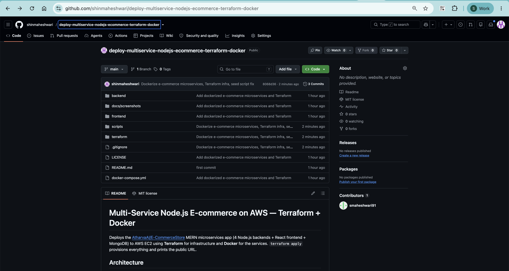

**Docker Hub: 5 public images**

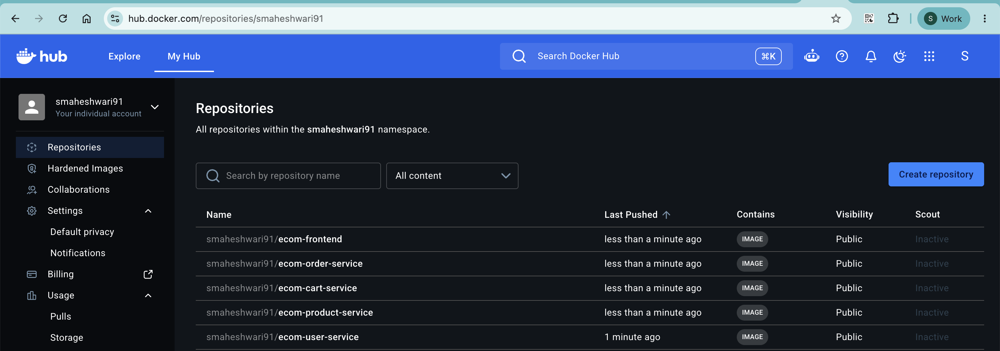

**Terraform plan: 12 resources to add**

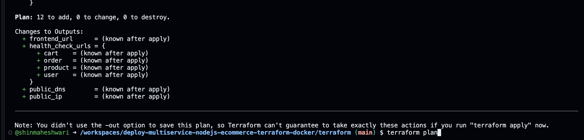

**Terraform apply and outputs (public IP and DNS)**

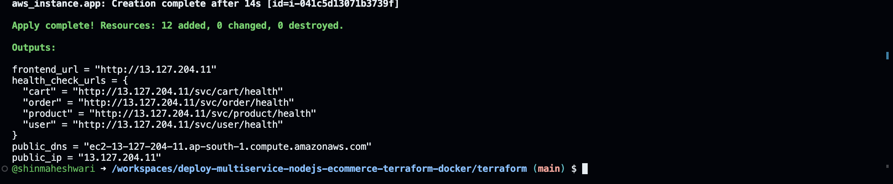

**AWS: EC2 instance running**

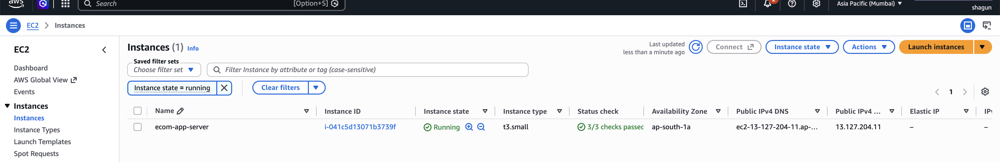

**AWS: VPC and public subnet**

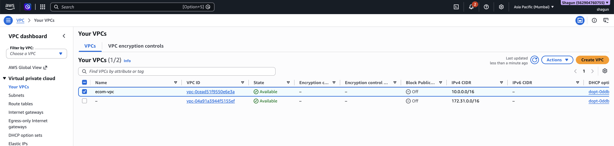

**AWS: security group inbound rules**

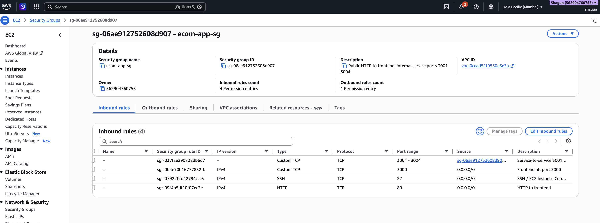

**Frontend publicly accessible, with products loaded from the product service**

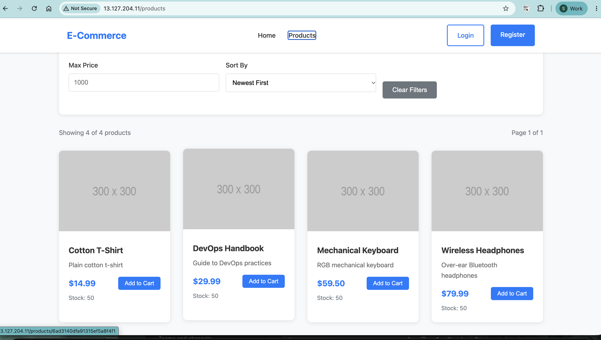

**Backend health checks (user, product, cart, order), all `OK`**

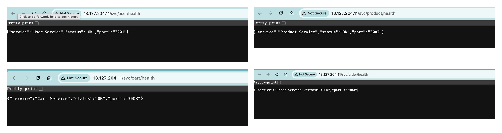

**All 6 containers running on the instance**

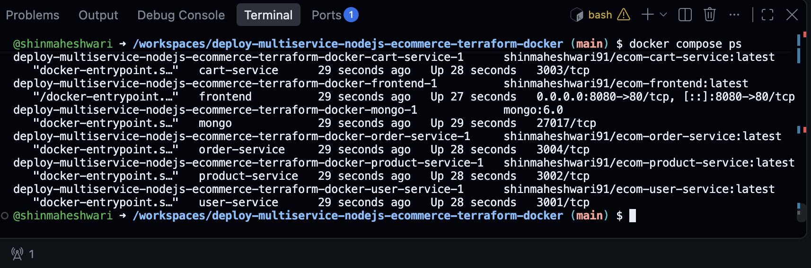

**Teardown: `terraform destroy`**

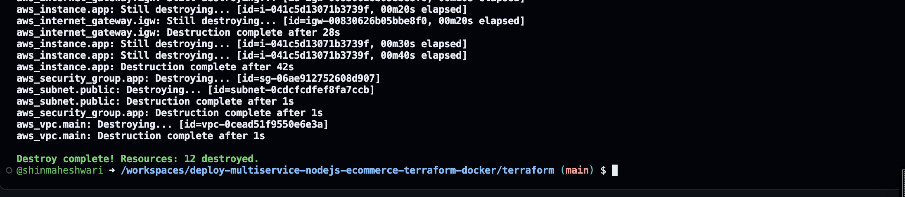

## Issues encountered and fixes
| Problem | Cause | Fix |
|---|---|---|
| Backends exit with `MongooseServerSelectionError` right after start | The reference code has no connection retry, so it crashes if MongoDB isn't ready yet | user-data waits for MongoDB to answer a ping before starting the services |
| Frontend build fails with `Environment key "jest/globals" is unknown` | Create React App's ESLint config is incompatible with current npm | `DISABLE_ESLINT_PLUGIN=true` in the frontend Dockerfile |
| `docker push` rejected with `insufficient_scope` | Wrong Docker Hub namespace and login identity | Logged in with the real username and a Read & Write access token, then retagged |
| Seed script: `Path 'slug' is required` | The reference `Category` model validates `slug` before its save hook can generate it | `scripts/seed.js` sends the slug explicitly |
| Container networking failed in the cloud dev sandbox used for the build | Sandbox limitation, not an application issue | End-to-end verification was done on the real EC2 instance (see screenshots) |

## Credits and licence
Application code from [AtharvaAI/E-CommerceStore](https://github.com/AtharvaAI/E-CommerceStore) (MIT).
Added in this repository: Dockerfiles, nginx configuration, docker-compose, Terraform, seed script and documentation.